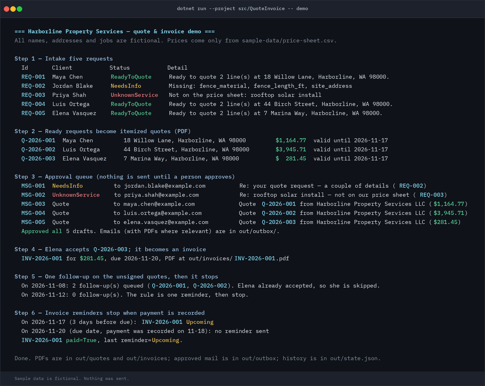
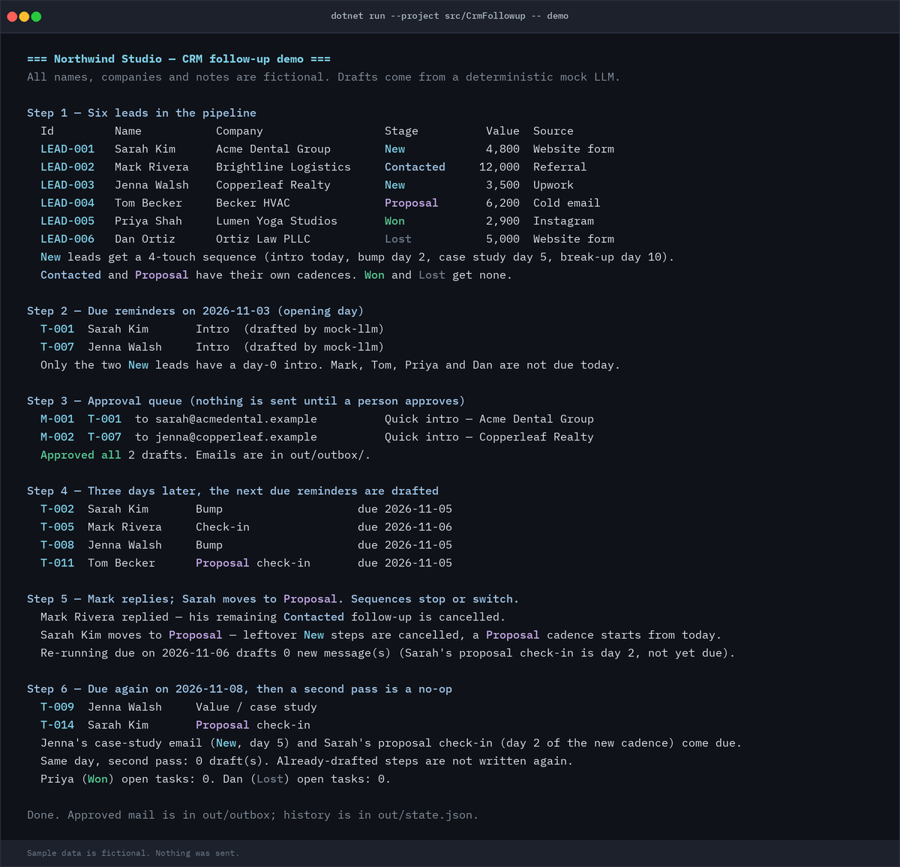
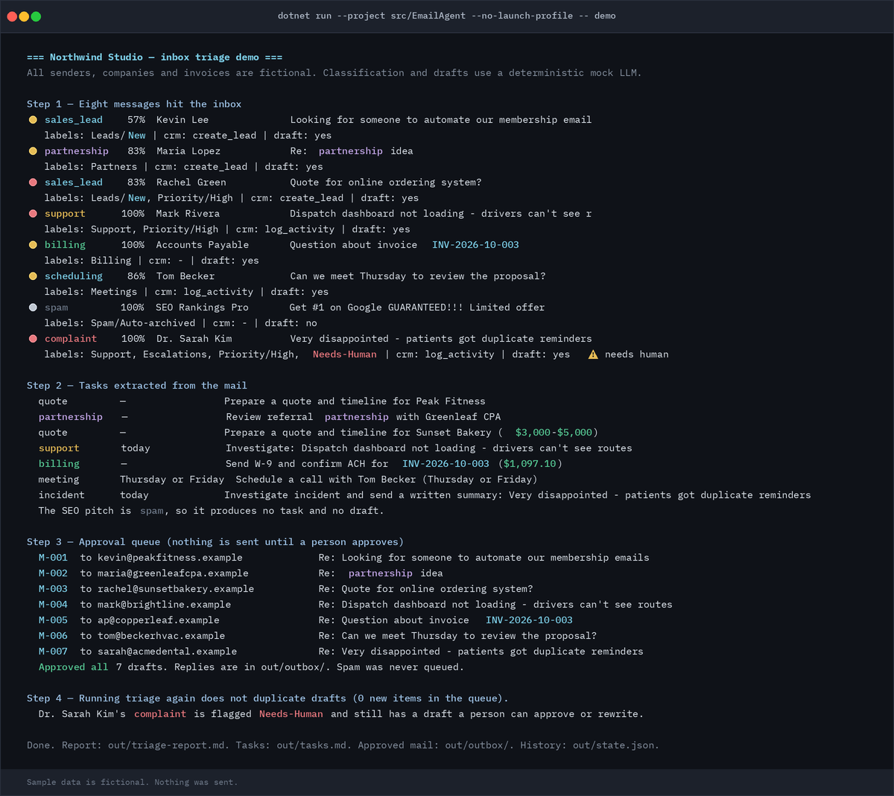

# AI automation demos

Three small, working .NET 8 apps that show the back-office loops I build for service businesses: quotes and invoices, CRM follow-up, and inbox triage.

Each demo ships with passing tests, a human approval step before any email is sent, and **fictional sample data**. They run offline — no API key is required. They are not connected to a live mailbox, CRM, or accounting tool.

## Quote & invoice automation

**Folder:** [`demos/quote-invoice/`](demos/quote-invoice/)

A request comes in, a priced PDF quote goes out, one follow-up if it sits unsigned, and an accepted quote becomes an invoice whose reminders stop when payment is recorded. Prices come only from the price sheet; missing details and services not on the sheet are flagged, never invented. Every message waits in an approval queue until a person approves it. The Harborline Property Services sample — customers, jobs, prices and payments — is fictional. 23 automated tests.



## CRM with automatic follow-up

**Folder:** [`demos/crm-followup/`](demos/crm-followup/)

A sales pipeline that does not go quiet: each active stage has its own follow-up cadence, due reminders are drafted from the lead's context, and nothing is sent until a person approves it. Sequences pause when the lead replies or the deal is won or lost, and they switch when the lead changes stage. The default writer is a deterministic mock so it runs offline; the same contract can call OpenAI and falls back to the mock on error. The Northwind Studio leads and companies in the sample are fictional. 23 automated tests.



## Inbox triage agent

**Folder:** [`demos/email-agent/`](demos/email-agent/)

Every message in a shared inbox is classified (lead, support, billing, scheduling, partnership, complaint or spam) with a priority and a confidence score. Tasks are extracted from the mail, replies are drafted, complaints and low-confidence cases are flagged for a human, and spam produces no draft and no task. Nothing is sent until a person approves it. The default engine is a mock so it runs offline; OpenAI is optional, with automatic fallback. All senders, companies and invoices in the sample are fictional. 22 automated tests.



## How to run

Requires the [.NET 8 SDK](https://dotnet.microsoft.com/download/dotnet/8.0) (tested with SDK 10 targeting `net8.0`).

Run these from the repository root:

### Quote & invoice automation

```bash
cd demos/quote-invoice
dotnet test          # 23 tests
dotnet run --project src/QuoteInvoice -- demo
```

Outputs land in `out/` (quote and invoice PDFs, approved `.eml` files, and `state.json`).

### CRM with automatic follow-up

```bash
cd demos/crm-followup
dotnet test          # 23 tests
dotnet run --project src/CrmFollowup -- demo
```

Outputs land in `out/` (approved `.eml` files and `state.json`). Optional live model: `export OPENAI_API_KEY=...` and add `--engine openai` (falls back to the mock writer on error).

### Inbox triage agent

```bash
cd demos/email-agent
dotnet test          # 22 tests
dotnet run --project src/EmailAgent --no-launch-profile -- demo
```

Outputs land in `out/` (`triage-report.md`, `tasks.md`, approved `.eml` files, and `state.json`). Optional live model: `export OPENAI_API_KEY=...` and add `--engine openai` (falls back to the mock engine on error).

Each demo folder has a README with more commands and a `LOOM_SCRIPT.md` for a ~2-minute walkthrough.

## About

Leonardo Apollonio — senior .NET / full-stack engineer (~9 years of production C#, including RAG and LLM work with Semantic Kernel).

GitHub: [github.com/leo8190](https://github.com/leo8190)
